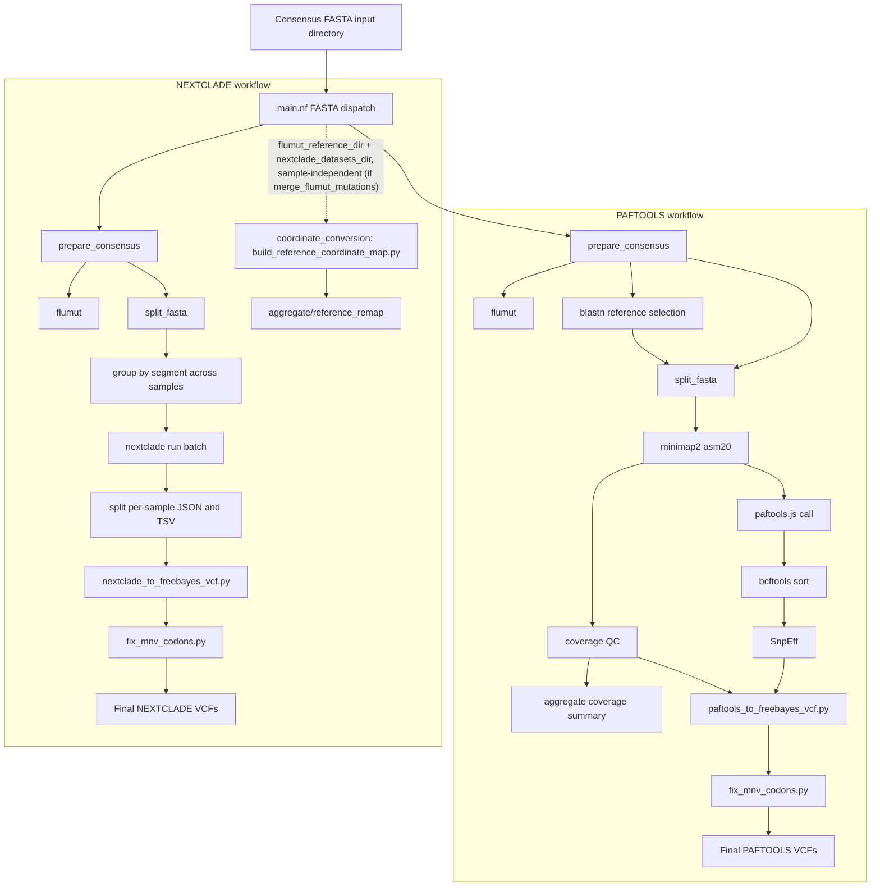

# fluscan-nf

This is a Nextflow pipeline for Influenza A mutation analysis from either short-read FASTQ data or pre-built consensus FASTA files.
The short-read workflow performs trimming, assembly, mapping, LoFreq variant calling, SnpEff annotation, and consensus generation. In FASTA mode (`--fasta_input`), the pipeline currently launches both a PAFTOOLS branch and a NEXTCLADE branch: PAFTOOLS validates the supplied FASTA, selects a subtype-matched reference with BLAST, aligns per segment with `minimap2`, calls differences with `paftools.js`, sorts with `bcftools`, annotates with SnpEff, and fixes multi-nucleotide variant codons; NEXTCLADE validates the same input, batches sequences by segment for `nextclade run`, converts the results to VCF, and applies the same MNV codon correction step.

## Analyses

### Short-read workflow
- Read trimming & QC: [fastp](https://github.com/OpenGene/fastp)
- Primer removal with [cutadapt](https://github.com/marcelm/cutadapt)
- FASTQ quality reporting with [FastQC](https://www.bioinformatics.babraham.ac.uk/projects/fastqc/)
- Aggregate the reports with [MultiQC](https://multiqc.info/)
- De-novo assembly
- Automated reference selection from built-in database via BLAST
- Reference-based read mapping (BWA or minimap2)
- Nucleotide variant calling using [LoFreq](https://csb5.github.io/lofreq/)
- Annotation of amino acid variant calls using SnpEff
- MNV codon correction
- Detection of mutations of interest via watchlist scanning
- Consensus sequence generation
- Detection of influenza molecular markers with [FluMut](https://izsvenezie-virology.github.io/FluMut/docs/usage/usage-cli)

### PAFTOOLS workflow (consensus FASTA input)
- Consensus FASTA validation and header normalisation
- Automated reference selection from built-in database via BLAST
- Per-segment alignment using minimap2 (`asm20` mode)
- Variant calling using `paftools.js`
- VCF sorting with `bcftools sort`
- Annotation of amino acid variant calls using SnpEff
- MNV codon correction
- Alignment coverage QC with run-level aggregation
- Detection of influenza molecular markers with [FluMut](https://izsvenezie-virology.github.io/FluMut/docs/usage/usage-cli)

### NEXTCLADE workflow (consensus FASTA input)
- Consensus FASTA validation and header normalisation
- Per-segment batching across samples
- Per-segment `nextclade run` against built-in datasets
- Per-sample JSON/TSV splitting from the batch results
- Conversion to freebayes-style VCF
- MNV codon correction
- Detection of influenza molecular markers with [FluMut](https://izsvenezie-virology.github.io/FluMut/docs/usage/usage-cli)
- *Optional* (`--merge_flumut_mutations`, default off): reference coordinate conversion — builds a run-level, idempotent nucleotide/amino-acid coordinate map lifting flumut's fixed reference onto the selected Nextclade reference dataset coordinate system (`bin/build_reference_coordinate_map.py`) — followed by merging flumut mutations into the VCF, so flumut markers are remapped into Nextclade coordinates and inserted alongside the fluscan calls




## Input

**Short-read workflow:** Illumina paired-end FASTQ files (`*.fastq.gz`, `*.fq.gz`, `*.fastq`, `*.fq`), or a samplesheet CSV with columns `ID`, `R1`, `R2`.

**PAFTOOLS/NEXTCLADE workflows:** Consensus FASTA files (one multi-FASTA per sample, one sequence per influenza segment). Two header formats are accepted:
- Underscore-delimited (legacy): `>SAMPLE_ID_segmentN_SEGMENT` e.g. `>WIN-AH-2024-FAV-0415_segment1_PB2`
- Pipe-delimited (GISAID-style): `>EPI_ISL_ACCESSION|subtype|SEGMENT|...|clade_SEGMENT` e.g. `>EPI_ISL_20399898|A_/_H5N1|NA|6|EPI5261179|2.3.4.4b_NA`

Cleaned output headers (`{sample_id}.fasta`) are normalised to `{sample_id}_{SEGMENT}` (e.g. `EPI-ISL-20399898_NA`).

## Usage

**Example command (short-read):**
```
nextflow run BCCDC-PHL/fluscan-nf \
  -r v0.1.0 \
  -profile conda \
  --cache ~/.conda/envs \
  --fastq_input /path/to/your_fastqs \
  --outdir /path/to/output_dir
```

Optional short-read parameters:
- `--samplesheet_input` — CSV samplesheet (`ID,R1,R2`) consumed by the short-read workflow; note that `main.nf` currently still switches into short-read mode based on `--fastq_input`
- `--watchlist_dir` — directory containing `*watchlist.csv` files for mutation-of-interest scanning
- `--snpeff_config` — path to a custom SnpEff config (defaults to the built-in database)
- `--aligner` — `bwa` (default) or `minimap2`

**FASTA-mode example (runs both PAFTOOLS and NEXTCLADE):**
```
nextflow run BCCDC-PHL/fluscan-nf \
  -r v0.1.0 \
  -profile conda \
  --cache ~/.conda/envs \
  --fasta_input /path/to/consensus_fastas \
  --snpeff_config /path/to/snpeff.config \
  --outdir /path/to/output_dir
```

> **Note:** FASTA mode requires `params.snpeff_config` to resolve to an existing SnpEff config because the PAFTOOLS branch requires it. By default this comes from the built-in database configured in `nextflow.config`; use `--snpeff_config` to override it. In the short-read workflow, `--snpeff_config` is optional and also defaults to the built-in config.
>
> The NEXTCLADE branch additionally requires `--nextclade_datasets_dir` (the selected Nextclade reference dataset, containing one subdirectory per segment — the canonical *target* coordinate system), which must point to an existing directory or the pipeline will error out before running.
>
> `--merge_flumut_mutations` (boolean, default `false`) gates the two final NEXTCLADE steps — coordinate conversion and merging flumut mutations into the VCF (`*_flumut_merged.vcf`). When set to `true`, `--flumut_reference_dir` (flumut's Nextclade dataset directory — the fixed *source* reference lifted onto the target by the `coordinate_conversion` step) becomes mandatory and must point to an existing directory, or the pipeline will error out before running.

**Package management:**
- Conda is used for dependency management. The `-profile conda` flag and `--cache` parameter are required on BCCDC systems.
- If environment resolution fails on first run, ensure `mamba` is available (the pipeline uses `conda.useMamba = true`).

## Output

Outputs are written to the directory specified with the `--outdir` parameter.
Sample-level outputs are written to one folder per sample, and some workflows also emit run-level aggregate outputs.

### Short-read workflow outputs (per sample)

| File | Description |
|------|-------------|
| `*.fastp.html` | Per-sample fastp HTML report |
| `*.fastp.json` | Per-sample fastp JSON report |
| `*_contigs.fasta` | De-novo assembled contigs from SPAdes |
| `*_consensus.fasta` | Multi-FASTA containing the consensus sequences for each segment |
| `*_ref.fasta` | Multi-FASTA containing the optimal reference sequences selected for each segment |
| `*_blastn.tsv` | BLAST search results of assembled contigs against the reference database |
| `*_blastn_filter.tsv` | Filtered BLAST search results |
| `*.sort.filter.bam` | Sorted, filtered alignment BAM used for downstream calling and coverage calculations |
| `*_coverage.png` | Line plots describing mapping coverage across all 8 flu segments |
| `*_pileup.tsv` | Pileup TSV with raw counts of all 4 nucleotides and gaps |
| `*_depth.tsv` | Per-position alignment depth (samtools depth) |
| `*_low_coverage.bed` | Low-coverage regions masked during consensus generation |
| `short_read/*_final.vcf` | Per-segment final VCF after SnpEff annotation and MNV codon correction |
| `flumut/*_flumut_markers.tsv` | FluMut table of molecular markers identified in the consensus sequences |
| `flumut/*_flumut_mutations.tsv` | FluMut long-format table of amino acid mutations at positions of interest |
| `flumut/*_flumut_mutations_wide.tsv` | FluMut wide-format table of amino acid mutations at positions of interest |
| `flumut/*_flumut_literature.tsv` | FluMut literature references associated with the identified markers |
| `*_provenance.yml` | Aggregated per-sample provenance file for the short-read workflow |

### PAFTOOLS workflow outputs (per sample, consensus FASTA input)

| File | Description |
|------|-------------|
| `${sample_id}.fasta` | Validated consensus FASTA with headers normalised to `{sample_id}_{SEGMENT}` |
| `*_qc_report.tsv` | QC report from consensus preparation |
| `*_ref.fasta` | Multi-FASTA containing the optimal reference sequences selected for each segment |
| `*_blastn.tsv` | BLAST search results against the reference database |
| `*_blastn_filter.tsv` | Filtered BLAST search results |
| `qc/*_coverage_qc.tsv` | Per-segment PAFTOOLS consensus coverage QC with coverage percentage and PASS/WARN/FAIL status |
| `paftools/*_final.vcf` | Per-segment final VCF after `paftools.js`, SnpEff, freebayes-style conversion, and MNV codon correction |
| `flumut/*_flumut_markers.tsv` | FluMut table of molecular markers identified in the consensus sequences |
| `flumut/*_flumut_mutations.tsv` | FluMut long-format table of amino acid mutations at positions of interest |
| `flumut/*_flumut_mutations_wide.tsv` | FluMut wide-format table of amino acid mutations at positions of interest |
| `flumut/*_flumut_literature.tsv` | FluMut literature references associated with the identified markers |

### NEXTCLADE workflow outputs (per sample, consensus FASTA input)

| File | Description |
|------|-------------|
| `nextclade/json/*_nextclade.json` | Per-segment Nextclade JSON split out from the cross-sample batch result |
| `nextclade/tsv/*_nextclade.tsv` | Per-segment Nextclade TSV split out from the cross-sample batch result |
| `nextclade/*_final.vcf` | Per-segment final VCF after Nextclade-to-VCF conversion and MNV codon correction |
| `flumut/*_flumut_markers.tsv` | FluMut table of molecular markers identified in the consensus sequences |
| `flumut/*_flumut_mutations.tsv` | FluMut long-format table of amino acid mutations at positions of interest |
| `flumut/*_flumut_mutations_wide.tsv` | FluMut wide-format table of amino acid mutations at positions of interest |
| `flumut/*_flumut_literature.tsv` | FluMut literature references associated with the identified markers |

### Run-level outputs

| File | Description |
|------|-------------|
| `${run_name}_fluscan-nf_multiqc_report.html` | MultiQC report summarising fastp, cutadapt, and FastQC results for all samples (short-read workflow only) |
| `aggregate/run_coverage_summary.tsv` | Run-level tabular summary of PAFTOOLS alignment coverage across all FASTA samples and segments |
| `aggregate/reference_remap/coordinate_map.json` | Primary machine-readable nucleotide/amino-acid coordinate map lifting flumut's reference (source) onto the selected Nextclade reference dataset (target) (NEXTCLADE workflow only) |
| `aggregate/reference_remap/coordinate_map.nt.tsv` | Flat per-position nucleotide coordinate map (source/flumut position/base -> target/nextclade position/base, per segment) |
| `aggregate/reference_remap/coordinate_map.aa.tsv` | Flat per-residue amino-acid coordinate map (source/flumut position/residue -> target/nextclade position/residue, per segment/gene) |
| `aggregate/reference_remap/coordinate_map.qc.tsv` | Per-segment/per-gene alignment QC: identity, coverage, and status (`ok`/`warning`/`missing_in_source`/`extra_in_source`/`stale_annotation`) |
| `aggregate/reference_remap/<source>_alignment.fasta` | Target/source (nextclade/flumut) nucleotide alignment blocks, one per segment |
| `aggregate/reference_remap/<source>_aa_alignment.fasta` | Target/source (nextclade/flumut) amino-acid alignment blocks, one per gene |
| `${run_name}_fluscan-nf_nextflow_report.html` | Nextflow execution report |
| `${run_name}_fluscan-nf_nextflow_timeline.html` | Nextflow execution timeline |
| `${run_name}_fluscan-nf_nextflow_trace.txt` | Nextflow task trace |


## Provenance files

The short-read workflow currently publishes one aggregated `${sample_id}_<timestamp>_provenance.yml` file per sample. FASTA mode defines provenance outputs for several processes internally, but sample-level provenance collection is not currently enabled for the `PAFTOOLS` and `NEXTCLADE` workflows. Note the example below is contrived.  

```yml
- pipeline_name: BCCDC-PHL/fluscan-nf
  pipeline_version: 0.1.0
  nextflow_session_id: 59fdd919-fc28-4af5-99e0-60355b11807c
  nextflow_run_name: hopeful_bhaskara
  timestamp_analysis_start: 2024-07-15T16:30:11.150887-07:00
- input_filename: sample-01_R1.fastq.gz
  file_type: fastq_input
  sha256: 2c1d5b310a5ca11cc2b1665c094a064fc3aa597e06f392985dac639bd2ab4d81
- input_filename: sample-01_R2.fastq.gz
  file_type: fastq_input
  sha256: 73745eed4badc3594cdd8554e90c75ae4b9b4599ca255064415ded433e598749
- process_name: fastp
  tools:
    - tool_name: fastp
      tool_version: 0.23.2
- process_name: cutadapt
  tools:
    - tool_name: cutadapt
      tool_version: 4.4
- process_name: assembly
  tools:
    - tool_name: spades
      tool_version: v3.15.3
- process_name: lofreq
  tools:
    - tool_name: samtools
      tool_version: 1.18
    - tool_name: lofreq
      tool_version: 2.1.5
    - tool_name: bcftools
      tool_version: 1.18
- process_name: flumut
  tools:
    - tool_name: flumut
      tool_version: 0.8.0
```
