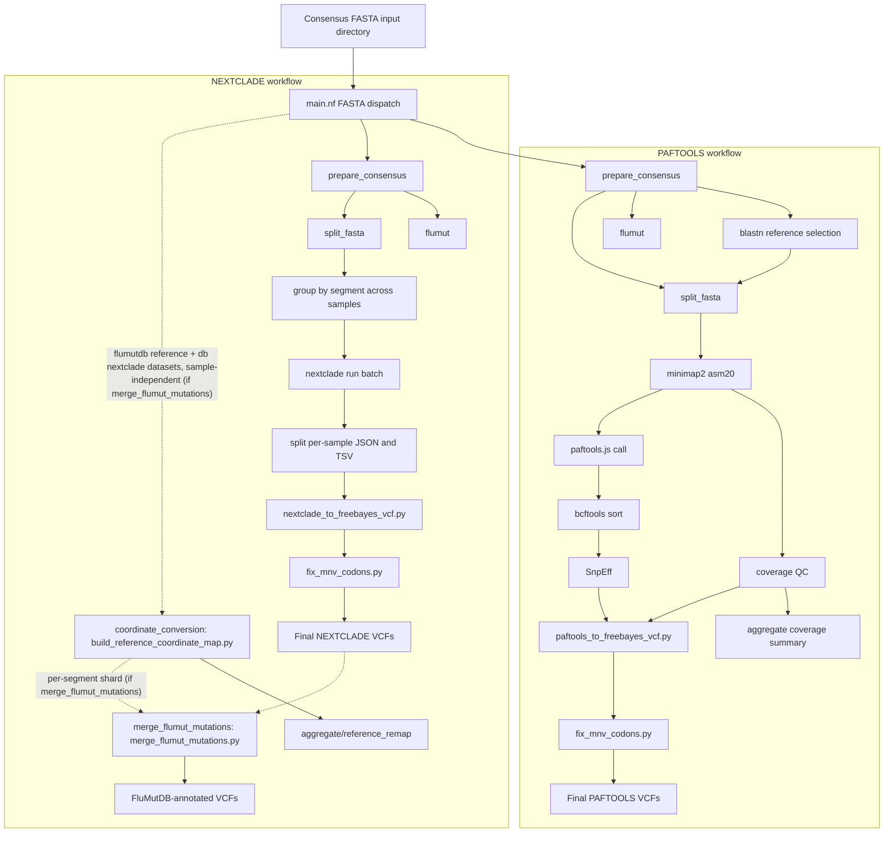

# fluscan-nf

This is a Nextflow pipeline for Influenza A mutation analysis from either short-read FASTQ data or pre-built consensus FASTA files.
The short-read workflow performs trimming, assembly, mapping, LoFreq variant calling, SnpEff annotation, and consensus generation. In FASTA mode (`--fasta_input`), the pipeline currently launches both a PAFTOOLS branch and a NEXTCLADE branch: PAFTOOLS validates the supplied FASTA, selects a subtype-matched reference with BLAST, aligns per segment with `minimap2`, calls differences with `paftools.js`, sorts with `bcftools`, annotates with SnpEff, and fixes multi-nucleotide variant codons; NEXTCLADE validates the same input, batches sequences by segment for `nextclade run`, converts the results to VCF, and applies the same MNV codon correction step.

## Analyses

### Short-read workflow
- Read trimming & QC: [fastp](https://github.com/OpenGene/fastp)
- Primer removal with [cutadapt](https://github.com/marcelm/cutadapt)
- FASTQ quality reporting with [FastQC](https://www.bioinformatics.babraham.ac.uk/projects/fastqc/)
- Aggregate the reports with [MultiQC](https://multiqc.info/)
- De-novo assembly
- Automated reference selection from built-in database via BLAST
- Reference-based read mapping (BWA or minimap2)
- Nucleotide variant calling using [LoFreq](https://csb5.github.io/lofreq/)
- Annotation of amino acid variant calls using SnpEff
- MNV codon correction
- Detection of mutations of interest via customisable watchlist scanning of the final VCF
- Consensus sequence generation
- Detection of influenza molecular markers with [FluMut](https://izsvenezie-virology.github.io/FluMut/docs/usage/usage-cli)

### PAFTOOLS workflow (consensus FASTA input)
- Consensus FASTA validation and header normalisation
- Automated reference selection from built-in database via BLAST
- Per-segment alignment using minimap2 (`asm20` mode)
- Variant calling using `paftools.js`
- VCF sorting with `bcftools sort`
- Annotation of amino acid variant calls using SnpEff
- MNV codon correction
- Alignment coverage QC with run-level aggregation
- Detection of influenza molecular markers with [FluMut](https://izsvenezie-virology.github.io/FluMut/docs/usage/usage-cli)

### NEXTCLADE workflow (consensus FASTA input)
- Consensus FASTA validation and header normalisation
- Per-segment batching across samples
- Per-segment `nextclade run` against built-in datasets
- Per-sample JSON/TSV splitting from the batch results
- Conversion to freebayes-style VCF
- MNV codon correction
- Detection of influenza molecular markers with [FluMut](https://izsvenezie-virology.github.io/FluMut/docs/usage/usage-cli)
- *Optional* (`--merge_flumut_mutations`, default off): reference coordinate conversion — builds a run-level, idempotent nucleotide/amino-acid coordinate map lifting flumut's fixed reference onto the selected Nextclade reference dataset coordinate system (`bin/build_reference_coordinate_map.py`) — followed by FluMutDB annotation of the VCF, which tags each fluscan amino-acid call that matches a curated FluMutDB marker with a `FLUMUT=` INFO field carrying the mutation name and its published effects, split into those directly attributable to that mutation and those associated with it through a multi-mutation marker, each qualified by the subtype it was observed in. No rows are added or removed, so a marker is only reported where fluscan called a difference from the Nextclade reference. Because FluMutDB numbers HA by its HA1/HA2 subunits, HA markers are only annotated when the Nextclade dataset also exposes that split — either as two dedicated `HA1`/`HA2` CDS features, or as `mature_protein_region_of_CDS` children of a single HA CDS (the NCBI/RefSeq model, which the GsGD dataset uses). A dataset offering only a bare `HA` CDS is flagged `stale_annotation` and passes through with its HA rows unannotated




## Input

**Short-read workflow:** Illumina paired-end FASTQ files (`*.fastq.gz`, `*.fq.gz`, `*.fastq`, `*.fq`), or a sample sheet (below).

**PAFTOOLS/NEXTCLADE workflows:** Consensus FASTA files (one multi-FASTA per sample, one sequence per influenza segment). Two header formats are accepted:
- Underscore-delimited (legacy): `>SAMPLE_ID_segmentN_SEGMENT` e.g. `>WIN-AH-2024-FAV-0415_segment1_PB2`
- Pipe-delimited (GISAID-style): `>EPI_ISL_ACCESSION|subtype|SEGMENT|...|clade_SEGMENT` e.g. `>EPI_ISL_20399898|A_/_H5N1|NA|6|EPI5261179|2.3.4.4b_NA`

Cleaned output headers (`{sample_id}.fasta`) are normalised to `{sample_id}_{SEGMENT}` (e.g. `EPI-ISL-20399898_NA`).

### Sample sheet input

`--samplesheet_input` takes a CSV in place of `--fastq_input` or `--fasta_input`. Its header picks the workflow:

```csv
ID,R1,R2
SAMPLE-01,/path/to/SAMPLE-01_R1.fastq.gz,/path/to/SAMPLE-01_R2.fastq.gz
SAMPLE-02,/path/to/SAMPLE-02_R1.fastq.gz,/path/to/SAMPLE-02_R2.fastq.gz
```

runs the short-read workflow, and

```csv
ID,FASTA
SAMPLE-01,/path/to/SAMPLE-01.fasta
SAMPLE-02,/path/to/SAMPLE-02.fasta
```

runs PAFTOOLS and NEXTCLADE. Other columns are ignored.

- Each `ID` is cleaned by the same rule as a FASTA filename (see the note under Usage), so `24-1234-IP7-SAMPLE_01` is reported as `SAMPLE-01`. After cleaning, an ID may contain only letters, digits, `.` and `-`.
- Relative paths resolve against the directory `nextflow run` is launched from; absolute paths are safer.
- The run stops before any task starts if a column or value is missing, a file does not exist, or two IDs clean to the same sample name.
- `run_name`, which prefixes the run-level reports, is the sample sheet's filename without `.csv`.
- Give only one of `--fastq_input`, `--fasta_input` and `--samplesheet_input`.

## Reference databases

Every reference the pipeline needs for one reference set lives in a single directory — a
*bundle* — passed as `--db`:

```
<db>/
├── db.yml            optional metadata (name, version, …)
├── blastn_db.fa      nt reference; headers accession|subtype|segment
├── nextclade/        one uppercase directory per segment (HA/, NA/, …)
└── snpeff/           snpEff.config + <genome>/
```

Bundles may be partial — each workflow validates only the components it consumes, and
fails at the start of the run, before any task is submitted, naming the path it expected.
See [docs/database_bundles.md](docs/database_bundles.md) for the full layout, the
`db.yml` schema, and how to build and validate a bundle.

```bash
scripts/validate_db.py /path/to/refs/gsgd
```

## Usage

**Example command (short-read):**
```
nextflow run BCCDC-PHL/fluscan-nf \
  -r v0.1.0 \
  -profile conda \
  --cache ~/.conda/envs \
  --fastq_input /path/to/your_fastqs \
  --db /path/to/refs/gsgd \
  --outdir /path/to/output_dir
```

To run from a sample sheet, replace `--fastq_input` (or `--fasta_input` below) with `--samplesheet_input /path/to/samplesheet.csv`; see [Sample sheet input](#sample-sheet-input).

Optional short-read parameters:
- `--aligner` — `bwa` (default) or `minimap2`

Optional in every workflow:
- `--watchlist_dir` — directory of `*watchlist.csv` files (`gene,mutation[,note]`) scanned out of the final VCF into a published TSV. Defaults to `assets/watchlists/`; set to `NO_FILE` to disable. `HA1`/`HA2` entries are matched against the reference annotation's mature-peptide coordinates, so they work whether or not the VCF annotates the subunits directly. See [docs/watchlists.md](docs/watchlists.md)

**FASTA-mode example (runs both PAFTOOLS and NEXTCLADE):**
```
nextflow run BCCDC-PHL/fluscan-nf \
  -r v0.1.0 \
  -profile conda \
  --cache ~/.conda/envs \
  --fasta_input /path/to/consensus_fastas \
  --db /path/to/refs/gsgd \
  --merge_flumut_mutations \
  --outdir /path/to/output_dir
```

> **Note:** In FASTA mode the sample name comes from the input filename (or the sample sheet `ID`, cleaned by the same rule), and it names every output. The filename is taken without its extensions, a trailing `_consensus` is dropped, underscores become dashes, and a leading submitter prefix of the form `24-1234-` or `24-1234-IP7-` is stripped — so `24-1234-IP7-SAMPLE_A_consensus.fasta` is reported as `SAMPLE-A`. Input FASTA headers are read only for the segment label; they do not affect naming.
>
> FASTA mode launches both branches, so the bundle must carry all three components: PAFTOOLS requires `blastn_db.fa` and `snpeff/`, NEXTCLADE requires `nextclade/` with all eight segment datasets.
>
> In the short-read workflow only `blastn_db.fa` is required. SnpEff annotation — and the MNV correction and watchlist scan that read its output — runs when the bundle carries a `snpeff/` directory, and is skipped when it does not; consensus and FluMut complete either way.
>
> `--merge_flumut_mutations` (boolean, default `false`) gates the two final NEXTCLADE steps — coordinate conversion and FluMutDB annotation of the VCF (`*_flumut_annotated.vcf`). The `coordinate_conversion` step lifts FluMut's own reference, read from the `flumutdb` conda package, onto the `--db` datasets. The marker set comes from the same package, so the two always match and the annotation step does not consume the per-sample `flumut` output.
>
> `--emit_no_mature_vcf` (boolean, default `false`) additionally writes each NEXTCLADE VCF a second time with no mature-peptide `ANN=` entries, for consumers that require HA annotated as HA0 only. The two files carry the same records, alleles and order; only the `ANN=` sub-field differs, and segments without mature peptides in their annotation come out identical. The published copy lands in `nextclade/no_mature_peptide/` and gets the same MNV codon correction as the standard VCF. Nothing downstream in the pipeline reads it: `mutation_watch` and `merge_flumut_mutations` resolve HA markers through the HA1/HA2 `Feature_ID` and stay on the standard VCF.

**Package management:**
- Conda is used for dependency management. The `-profile conda` flag and `--cache` parameter are required on BCCDC systems.
- If environment resolution fails on first run, ensure `mamba` is available (the pipeline uses `conda.useMamba = true`).

## Output

Outputs are written to the directory specified with the `--outdir` parameter.
Sample-level outputs are written to one folder per sample, and some workflows also emit run-level aggregate outputs.

### Short-read workflow outputs (per sample)

| File | Description |
|------|-------------|
| `*.fastp.html` | Per-sample fastp HTML report |
| `*.fastp.json` | Per-sample fastp JSON report |
| `*_contigs.fasta` | De-novo assembled contigs from SPAdes |
| `*_consensus.fasta` | Multi-FASTA containing the consensus sequences for each segment |
| `*_ref.fasta` | Multi-FASTA containing the optimal reference sequences selected for each segment |
| `*_blastn.tsv` | BLAST search results of assembled contigs against the reference database |
| `*_blastn_filter.tsv` | Filtered BLAST search results |
| `*.sort.filter.bam` | Sorted, filtered alignment BAM used for downstream calling and coverage calculations |
| `*_coverage.png` | Line plots describing mapping coverage across all 8 flu segments |
| `*_pileup.tsv` | Pileup TSV with raw counts of all 4 nucleotides and gaps |
| `*_depth.tsv` | Per-position alignment depth (samtools depth) |
| `*_low_coverage.bed` | Low-coverage regions masked during consensus generation |
| `short_read/*_final.vcf` | Per-segment final VCF after SnpEff annotation and MNV codon correction |
| `short_read/*_watchlist_hits.tsv` | *Optional* (`--watchlist_dir`): watchlist substitutions found in the final VCF |
| `flumut/*_flumut_markers.tsv` | FluMut table of molecular markers identified in the consensus sequences |
| `flumut/*_flumut_mutations.tsv` | FluMut long-format table of amino acid mutations at positions of interest |
| `flumut/*_flumut_mutations_wide.tsv` | FluMut wide-format table of amino acid mutations at positions of interest |
| `flumut/*_flumut_literature.tsv` | FluMut literature references associated with the identified markers |
| `*_short_read_*_provenance.yml` | Aggregated per-sample provenance file for the short-read workflow |

The PAFTOOLS and NEXTCLADE VCFs declare and write the placeholder `FORMAT/GQ` as an integer.

### PAFTOOLS workflow outputs (per sample, consensus FASTA input)

| File | Description |
|------|-------------|
| `${sample_id}.fasta` | Validated consensus FASTA with headers normalised to `{sample_id}_{SEGMENT}` |
| `*_qc_report.tsv` | QC report from consensus preparation |
| `*_ref.fasta` | Multi-FASTA containing the optimal reference sequences selected for each segment |
| `*_blastn.tsv` | BLAST search results against the reference database |
| `*_blastn_filter.tsv` | Filtered BLAST search results |
| `qc/*_coverage_qc.tsv` | Per-segment PAFTOOLS consensus coverage QC with coverage percentage and PASS/WARN/FAIL status |
| `paftools/*_final.vcf` | Per-segment final VCF after `paftools.js`, SnpEff, freebayes-style conversion, and MNV codon correction |
| `paftools/*_watchlist_hits.tsv` | *Optional* (`--watchlist_dir`): watchlist substitutions found in the final VCF |
| `flumut/*_flumut_markers.tsv` | FluMut table of molecular markers identified in the consensus sequences |
| `flumut/*_flumut_mutations.tsv` | FluMut long-format table of amino acid mutations at positions of interest |
| `flumut/*_flumut_mutations_wide.tsv` | FluMut wide-format table of amino acid mutations at positions of interest |
| `flumut/*_flumut_literature.tsv` | FluMut literature references associated with the identified markers |
| `*_paftools_*_provenance.yml` | Aggregated per-sample provenance file for the PAFTOOLS workflow |

### NEXTCLADE workflow outputs (per sample, consensus FASTA input)

| File | Description |
|------|-------------|
| `nextclade/json/*_nextclade.json` | Per-segment Nextclade JSON split out from the cross-sample batch result |
| `nextclade/tsv/*_nextclade.tsv` | Per-segment Nextclade TSV split out from the cross-sample batch result |
| `nextclade/*_final.vcf` | Per-segment final VCF after Nextclade-to-VCF conversion and MNV codon correction |
| `nextclade/no_mature_peptide/*_nc_nomat_final.vcf` | *Optional* (`--emit_no_mature_vcf`): the same records annotated without mature peptides, so HA carries only its HA0 `ANN=` entry and no HA1/HA2 ones |
| `nextclade/flumut_annotated/*_flumut_annotated.vcf` | *Optional* (`--merge_flumut_mutations`): the same VCF with a `FLUMUT=` INFO field (`Protein\|AA_Pos\|Alt_AA\|Mutation_Name\|DirectEffect\|AssociatedEffect`) on rows whose amino-acid change matches a curated FluMutDB marker |
| `nextclade/*_watchlist_hits.tsv` | *Optional* (`--watchlist_dir`): watchlist substitutions found in the final VCF. Independent of `--merge_flumut_mutations`: `FLUMUT=` is a curated annotation written *into* the VCF, this is a custom list scanned *out* of it |
| `flumut/*_flumut_markers.tsv` | FluMut table of molecular markers identified in the consensus sequences |
| `flumut/*_flumut_mutations.tsv` | FluMut long-format table of amino acid mutations at positions of interest |
| `flumut/*_flumut_mutations_wide.tsv` | FluMut wide-format table of amino acid mutations at positions of interest |
| `flumut/*_flumut_literature.tsv` | FluMut literature references associated with the identified markers |
| `*_nextclade_*_provenance.yml` | Aggregated per-sample provenance file for the NEXTCLADE workflow |

### Run-level outputs

| File | Description |
|------|-------------|
| `${run_name}_fluscan-nf_multiqc_report.html` | MultiQC report summarising fastp, cutadapt, and FastQC results for all samples (short-read workflow only) |
| `aggregate/paftools_qc_summary.tsv` | Run-level tabular summary of PAFTOOLS alignment coverage across all FASTA samples and segments |
| `aggregate/paftools_consensus_qc_summary.tsv` | Every `*_qc_report.tsv` row from consensus preparation, concatenated across the run (PAFTOOLS). A sample rejected at preparation — duplicate segment, or headers naming more than one sample — contributes no rows and is reported only in the Nextflow log |
| `aggregate/nextclade_consensus_qc_summary.tsv` | The same rows collected by the NEXTCLADE branch; both branches prepare the same inputs, so the two files agree |
| `aggregate/reference_remap/coordinate_map.json` | Primary machine-readable nucleotide/amino-acid coordinate map lifting flumut's reference (source) onto the selected Nextclade reference dataset (target) (NEXTCLADE workflow only) |
| `aggregate/reference_remap/coordinate_map.nt.tsv` | Flat per-position nucleotide coordinate map (source/flumut position/base -> target/nextclade position/base, per segment) |
| `aggregate/reference_remap/coordinate_map.aa.tsv` | Flat per-residue amino-acid coordinate map (source/flumut position/residue -> target/nextclade position/residue, per segment/gene) |
| `aggregate/reference_remap/coordinate_map.qc.tsv` | Per-segment/per-gene alignment QC: identity, coverage, the number of co-optimal alignments the map's gap placement was chosen from, and status (`ok`/`warning`/`missing_in_source`/`extra_in_source`/`stale_annotation`) |
| `aggregate/reference_remap/flumut_alignment.fasta` | Target/source (nextclade/flumut) nucleotide alignment blocks, one per segment |
| `aggregate/reference_remap/flumut_aa_alignment.fasta` | Target/source (nextclade/flumut) amino-acid alignment blocks, one per gene |
| `${run_name}_fluscan-nf_nextflow_report.html` | Nextflow execution report |
| `${run_name}_fluscan-nf_nextflow_timeline.html` | Nextflow execution timeline |
| `${run_name}_fluscan-nf_nextflow_trace.txt` | Nextflow task trace |


## Provenance files

All three workflows publish one aggregated `${sample_id}_<workflow>_<timestamp>_provenance.yml` file per sample, where `<workflow>` is `short_read`, `paftools`, or `nextclade`. FASTA mode runs both `PAFTOOLS` and `NEXTCLADE` over the same input, so each sample gets two files; the workflow label is what tells them apart.

Every record opens with the pipeline and reference-database header, followed by the SHA-256 of each input file — the paired FASTQs in short-read mode, the consensus FASTA in FASTA mode. A sample whose `prepare_consensus` or `blastn` step fails produces no provenance file at all, since those processes run `errorStrategy 'ignore'` and the collection joins are inner joins.

Note the example below is contrived.

```yml
- pipeline_name: BCCDC-PHL/fluscan-nf
  pipeline_version: 0.1.0
  nextflow_session_id: 59fdd919-fc28-4af5-99e0-60355b11807c
  nextflow_run_name: hopeful_bhaskara
  timestamp_analysis_start: 2024-07-15T16:30:11.150887-07:00
- input_filename: sample-01_R1.fastq.gz
  file_type: fastq_input
  sha256: 2c1d5b310a5ca11cc2b1665c094a064fc3aa597e06f392985dac639bd2ab4d81
- input_filename: sample-01_R2.fastq.gz
  file_type: fastq_input
  sha256: 73745eed4badc3594cdd8554e90c75ae4b9b4599ca255064415ded433e598749
- process_name: fastp
  tools:
    - tool_name: fastp
      tool_version: 0.23.2
- process_name: cutadapt
  tools:
    - tool_name: cutadapt
      tool_version: 4.4
- process_name: assembly
  tools:
    - tool_name: spades
      tool_version: v3.15.3
- process_name: lofreq
  tools:
    - tool_name: samtools
      tool_version: 1.18
    - tool_name: lofreq
      tool_version: 2.1.5
    - tool_name: bcftools
      tool_version: 1.18
- process_name: flumut
  tools:
    - tool_name: flumut
      tool_version: 0.8.0
```
