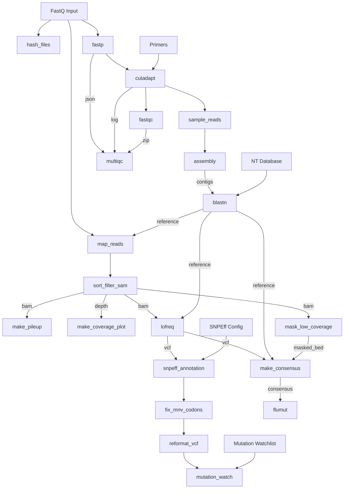

# fluscan-nf

This is a Nextflow pipeline for Influenza A mutation analysis from either short-read FASTQ data or pre-built consensus FASTA files.
The short-read workflow performs trimming, assembly, mapping, LoFreq variant calling, SnpEff annotation, and consensus generation. The consensus workflow validates the supplied FASTA, selects a subtype-matched reference with BLAST, aligns per-segment with `minimap2`, calls differences with `paftools.js`, sorts with `bcftools`, annotates with SnpEff, and fixes multi-nucleotide variant codons.

## Analyses

### Short-read workflow
- Read trimming & QC: [fastp](https://github.com/OpenGene/fastp)
- Primer removal with [cutadapt](https://github.com/marcelm/cutadapt)
- FASTQ quality reporting with [FastQC](https://www.bioinformatics.babraham.ac.uk/projects/fastqc/)
- Aggregate the reports with [MultiQC](https://multiqc.info/)
- De-novo assembly
- Automated reference selection from built-in database via BLAST
- Reference-based read mapping (BWA or minimap2)
- Nucleotide variant calling using [LoFreq](https://csb5.github.io/lofreq/)
- Annotation of amino acid variant calls using SnpEff
- MNV codon correction
- Detection of mutations of interest via watchlist scanning
- Consensus sequence generation
- Detection of influenza molecular markers with [FluMut](https://izsvenezie-virology.github.io/FluMut/docs/usage/usage-cli)

### Consensus workflow
- Consensus FASTA validation and header normalisation
- Automated reference selection from built-in database via BLAST
- Per-segment alignment using minimap2 (`asm20` mode)
- Variant calling using `paftools.js`
- VCF sorting with `bcftools sort`
- Annotation of amino acid variant calls using SnpEff
- MNV codon correction
- Genotype calling with [GenoFLU](https://github.com/USDA-VS/GenoFLU/)
- Detection of influenza molecular markers with [FluMut](https://izsvenezie-virology.github.io/FluMut/docs/usage/usage-cli)




## Input

**Short-read workflow:** Illumina paired-end FASTQ files (`*.fastq.gz`, `*.fq.gz`, `*.fastq`, `*.fq`), or a samplesheet CSV with columns `ID`, `R1`, `R2`.

**Consensus workflow:** Consensus FASTA files (one multi-FASTA per sample, one sequence per influenza segment). Expected header format: `>SAMPLE_ID_segmentN_SEGMENT` (e.g. `>WIN-AH-2024-FAV-0415_segment1_PB2`).

## Usage

**Example command (short-read):**
```
nextflow run BCCDC-PHL/fluscan-nf \
  -r v0.1.0 \
  -profile conda \
  --cache ~/.conda/envs \
  --fastq_input /path/to/your_fastqs \
  --outdir /path/to/output_dir
```

Optional short-read parameters:
- `--samplesheet_input` — CSV samplesheet (`ID,R1,R2`) as an alternative to `--fastq_input`
- `--watchlist_dir` — directory containing `*watchlist.csv` files for mutation-of-interest scanning
- `--snpeff_config` — path to a custom SnpEff config (defaults to the built-in database)
- `--aligner` — `bwa` (default) or `minimap2`

**Consensus FASTA example:**
```
nextflow run BCCDC-PHL/fluscan-nf \
  -r v0.1.0 \
  -profile conda \
  --cache ~/.conda/envs \
  --fasta_input /path/to/consensus_fastas \
  --snpeff_config /path/to/snpeff.config \
  --outdir /path/to/output_dir
```

> **Note:** `--snpeff_config` is **required** for the consensus workflow. It is optional for the short-read workflow, which falls back to the built-in SnpEff database.

**Package management:**
- Conda is used for dependency management. The `-profile conda` flag and `--cache` parameter are required on BCCDC systems.
- If environment resolution fails on first run, ensure `mamba` is available (the pipeline uses `conda.useMamba = true`).

## Output

Outputs are written to the directory specified with the `--outdir` parameter.
One folder is produced per sample.

### Short-read workflow outputs (per sample)

| File | Description |
|------|-------------|
| `*_consensus.fasta` | Multi-FASTA containing the consensus sequences for each segment |
| `*_ref.fasta` | Multi-FASTA containing the optimal reference sequences selected for each segment |
| `*_blast.tsv` | BLAST search results of assembled contigs against the reference database |
| `*_blast_filter.tsv` | Filtered BLAST search results |
| `*_coverage.png` | Line plots describing mapping coverage across all 8 flu segments |
| `*_pileup.tsv` | Pileup TSV with raw counts of all 4 nucleotides and gaps |
| `*_depth.tsv` | Per-position alignment depth (samtools depth) |
| `vcf/*.vcf.gz` | Variants in VCF format called by LoFreq relative to the reference sequence |
| `vcf/*__anno.vcf` | Per-segment VCF annotated with amino acid consequences by SnpEff |
| `vcf/*_anno_clean.vcf` | Per-segment VCF with MNV codon corrections applied |
| `vcf/*_mutations.tsv` | Reformatted, filtered VCF to simplify mutation identification |
| `vcf/*_mut_watch.tsv` | Mutations that are also present on the provided watchlist |
| `flumut/*_flumut_markers.tsv` | FluMut table of molecular markers identified in the consensus sequences |
| `flumut/*_flumut_mutations.tsv` | FluMut long-format table of amino acid mutations at positions of interest |
| `flumut/*_flumut_mutations_wide.tsv` | FluMut wide-format table of amino acid mutations at positions of interest |
| `flumut/*_flumut_literature.tsv` | FluMut literature references associated with the identified markers |

### Consensus workflow outputs (per sample)

| File | Description |
|------|-------------|
| `*_cleaned.fasta` | Validated, header-normalised consensus FASTA |
| `*_qc_report.tsv` | QC report from consensus preparation |
| `*_ref.fasta` | Multi-FASTA containing the optimal reference sequences selected for each segment |
| `*_blast.tsv` | BLAST search results against the reference database |
| `*_blast_filter.tsv` | Filtered BLAST search results |
| `vcf/*__anno.vcf` | Per-segment VCF annotated with amino acid consequences by SnpEff |
| `vcf/*_anno_clean.vcf` | Per-segment VCF with MNV codon corrections applied |
| `genoflu/*_stats.tsv` | Tabular genotype call information from GenoFLU |
| `flumut/*_flumut_markers.tsv` | FluMut table of molecular markers identified in the consensus sequences |
| `flumut/*_flumut_mutations.tsv` | FluMut long-format table of amino acid mutations at positions of interest |
| `flumut/*_flumut_mutations_wide.tsv` | FluMut wide-format table of amino acid mutations at positions of interest |
| `flumut/*_flumut_literature.tsv` | FluMut literature references associated with the identified markers |

### Run-level outputs

| File | Description |
|------|-------------|
| `multiqc_report.html` | MultiQC report summarising fastp, cutadapt, and FastQC results for all samples (short-read workflow only) |


## Provenance files

For each pipeline invocation, each sample will produce a `provenance.yml` file with the following contents.  Note the below is a contrived example.  

```yml
- pipeline_name: BCCDC-PHL/fluscan-nf
  pipeline_version: 0.1.0
  nextflow_session_id: 59fdd919-fc28-4af5-99e0-60355b11807c
  nextflow_run_name: hopeful_bhaskara
  timestamp_analysis_start: 2024-07-15T16:30:11.150887-07:00
- input_filename: sample-01_R1.fastq.gz
  file_type: fastq_input
  sha256: 2c1d5b310a5ca11cc2b1665c094a064fc3aa597e06f392985dac639bd2ab4d81
- input_filename: sample-01_R2.fastq.gz
  file_type: fastq_input
  sha256: 73745eed4badc3594cdd8554e90c75ae4b9b4599ca255064415ded433e598749
- process_name: fastp
  tools:
    - tool_name: fastp
      tool_version: 0.23.2
- process_name: cutadapt
  tools:
    - tool_name: cutadapt
      tool_version: 4.4
- process_name: assembly
  tools:
    - tool_name: spades
      tool_version: v3.15.3
- process_name: lofreq
  tools:
    - tool_name: samtools
      tool_version: 1.18
    - tool_name: lofreq
      tool_version: 2.1.5
    - tool_name: bcftools
      tool_version: 1.18
- process_name: flumut
  tools:
    - tool_name: flumut
      tool_version: 0.8.0
```
